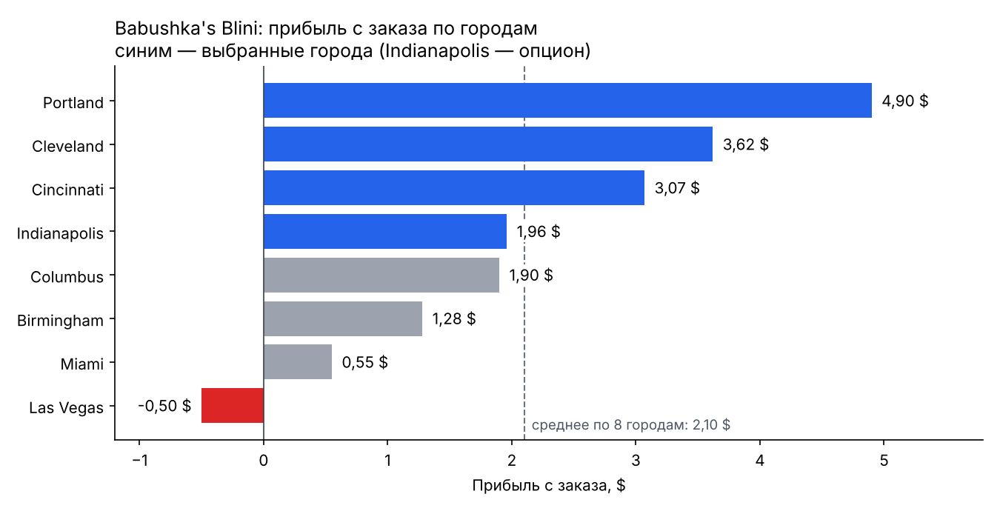

# Портфолио аналитических проектов — Софья Цикунова

Стажёр — аналитик данных / продуктовый аналитик · Москва
[tsikunova.sofia@gmail.com](mailto:tsikunova.sofia@gmail.com) · Telegram [@Sofiaaaats](https://t.me/Sofiaaaats) · [Профиль и резюме](https://github.com/tsikunovasofia-droid)

Проекты выполнены в командах на программе «Аналитик данных» Changellenge Education и на кейс-чемпионате Changellenge Cup Russia 2026. Каждый проект описан по схеме **задача → данные → мой вклад → результат**.

## Содержание

1. [Babushka's Blini: выход сети блинных на рынок США](#1-babushkas-blini-выход-сети-блинных-на-рынок-сша)
2. [Конференция в Бостоне: размещение 150 участников через Airbnb](#2-конференция-в-бостоне-размещение-150-участников-через-airbnb)
3. [Changellenge Cup Russia 2026: токенизация ЗПИФ для молодёжи](#3-changellenge-cup-russia-2026-токенизация-зпиф-для-молодёжи)
4. [Железнодорожный туризм для молодёжи (кейс РЖД)](#4-железнодорожный-туризм-для-молодёжи-кейс-ржд)

### Ключевые цифры

| Проект | Главный результат |
|---|---|
| Babushka's Blini | Средняя прибыль 3,66 $ с заказа — **+74%** к среднему по 8 городам |
| Конференция в Бостоне | Экономия **8 090 $ (12%)** бюджета при удовлетворённости 8,1/10 |
| Changellenge Cup Russia 2026 | **Топ-15%** отбора; NPV 1,47 млрд ₽, LTV/CAC > 6 |
| Кейс РЖД | Бизнес-кейс цифрового продукта с планом MVP |

---

## 1. Babushka's Blini: выход сети блинных на рынок США

**Changellenge Education, технический проект №2 · сентябрь 2026 · команда из 10 человек**

**Задача.** Выбрать города для выхода сети блинных на рынок США, число пилотных точек и районы для них.

**Данные.** Datafiniti (10 000 ресторанов fast food в США, 2019), перепись населения США, данные R&D.

**Мой вклад**
- Подготовила технические файлы проекта.
- Рассчитала цены для 8 городов с поправкой на местные зарплаты:
  `цена в городе = цена в РФ × 0,4 × (зарплата в городе / зарплата в РФ)`. Прибыль с заказа — от −0,50 $ (Las Vegas) до 4,90 $ (Portland).
- Рассчитала веса 4 критериев спроса методом анализа иерархий Саати: плотность населения 51%, рынок блинчиков 30%, турпоток 12%, расходы туристов 7%. Отношение согласованности 0,06 при норме ≤ 0,10.
- Построила сценарий премиальных цен для Las Vegas с учётом эластичности (от −0,3 до −1,1, база 700 заказов в день): **+50% к цене переводит точку из убытка −352 $ в прибыль +1 291 $ в день**.

**Работа команды.** Кластеризация районов HDBSCAN; автоматизация Excel-модели — новый город добавляется одной строкой.

**Результат.** Из 8 городов выбраны 4 — Portland, Cleveland, Cincinnati и опцион Indianapolis, — и 5 пилотных ресторанов. Средняя прибыль **3,66 $ с заказа, на 74% выше** среднего по 8 городам (2,10 $).

**Стек:** Excel (FILTER, CHOOSECOLS, ИНДЕКС + ПОИСКПОЗ), Python (pandas, HDBSCAN), юнит-экономика, метод Саати.

---

## 2. Конференция в Бостоне: размещение 150 участников через Airbnb

**Changellenge Education, технический проект**

**Задача.** Разместить 150 участников конференции (из них 10 VIP) при бюджете на жильё 70 000 $ и удовлетворённости не ниже 8 из 10.

**Данные.** Boston Airbnb Open Data, статистика преступности Бостона, погодные данные NOAA.

**Что сделано**
- Обработала датасет Boston Airbnb Open Data, сравнила стоимость жилья и такси по 17 районам.
- Построила взвешенную функцию удовлетворённости из 5 факторов (веса 20 / 30 / 20 / 10 / 10%).
- Рассчитала порог выгодности автобуса против Uber: автобус дешевле на **6 390 $ за 5 дней**, запас до порога 40%.

**Результат.** Бюджет **61 910 $ из 70 000 $** (экономия 8 090 $, 12%) при удовлетворённости **8,1 из 10**.

**Стек:** Excel (очистка данных, многокритериальный анализ, финансовая модель), PowerPoint.

---

## 3. Changellenge Cup Russia 2026: токенизация ЗПИФ для молодёжи

**Всероссийский кейс-чемпионат · топ-15% отборочного этапа · команда «Где родился — там и метр», 5 человек · роль — маркетолог**

**Задача.** Кейс «Современных фондов недвижимости»: довести долю молодых инвесторов среди пайщиков ЗПИФ коммерческой недвижимости с 3% до 10% за 3 года.

**Мой вклад**
- Бенчмаркинг 5 компаний (Ark7, Fundrise, ПАРУС, ВИМ Инвестиции, Т-Инвестиции) и механик удержания из 4 отраслей: гейминг, EdTech, необанки, e-commerce.
- Анализ каналов привлечения поколения Z.
- Воронка привлечения из 4 этапов:
  1. QR-коды на коробках Ozon и мидл-блогеры;
  2. бонус без депозита;
  3. геймификация и автоокругление;
  4. конверсия бонусов в паи.

**Работа команды.** CustDev на 52 респондентах; TAM 17–20 млн / SAM 3–4 млн / SOM 50–70 тыс.; сегментация по JTBD, CJM, матрица рисков, роадмап на 3 года.

**Результат.** +45 тыс. молодых инвесторов за 3 года при CAPEX 47 млн ₽; **NPV 1,47 млрд ₽**, LTV от 17 тыс. ₽, **LTV/CAC > 6**.

**Стек:** Excel (финансовая модель), Google Формы (CustDev), PowerPoint.

---

## 4. Железнодорожный туризм для молодёжи (кейс РЖД)

**Changellenge Education, кейс-проект**

**Задача.** Предложить, как развить железнодорожный туризм в сегменте 18–35 лет.

**Что сделано**
- Структурировала задачу по SMART, MECE и PSW, построила дерево гипотез драйверов роста сегмента.
- Составила CJM и концепцию цифрового продукта.
- Оценила влияние решения на конверсию, пассажиропоток, выручку и ROI.

**Результат.** Бизнес-кейс с планом запуска MVP.

**Стек:** Excel, Miro, PowerPoint.

---

